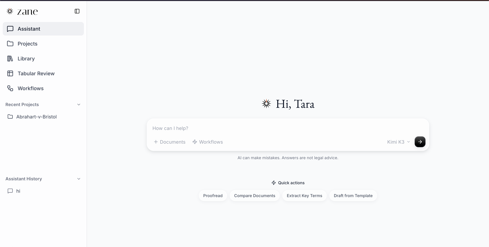
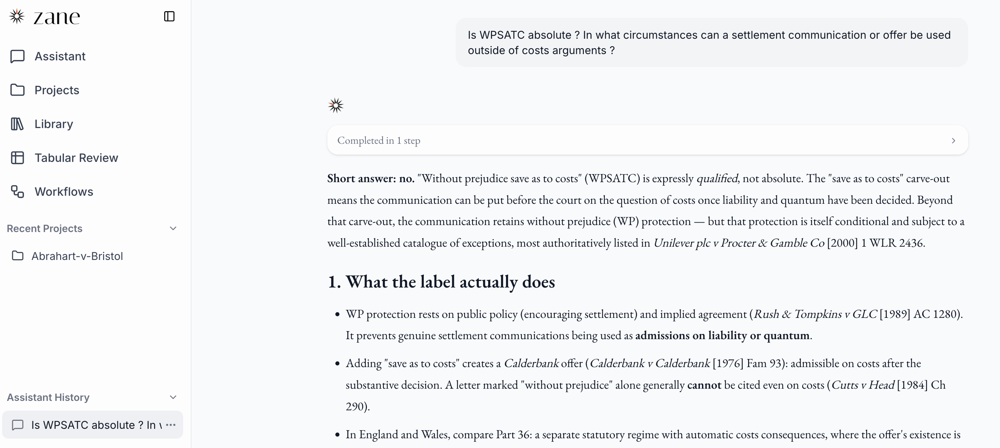
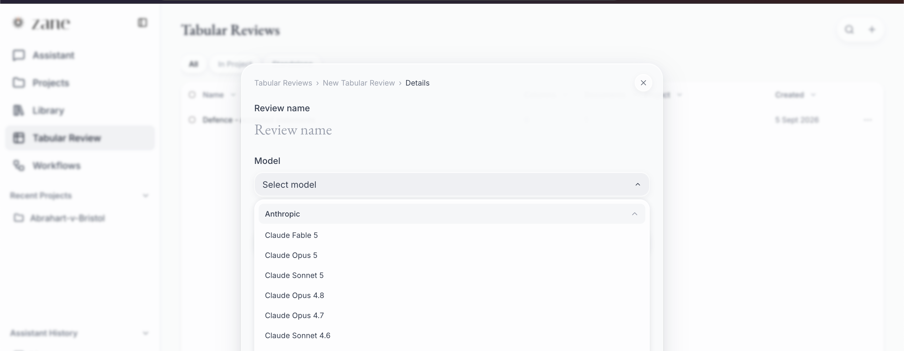

# zane

Zane (zaneOSS) is an open-source legal AI platform for document review,
drafting, and legal research built on top of Mike OSS.

It combines a Next.js frontend, an Express backend, Supabase Auth/Postgres,
and Cloudflare R2-compatible object storage.

## Screenshots

<p align="center">
  
  <br>
  <sub><b>Assistant.</b> Start a conversation, open a project, or move between
  the library, tabular reviews, and workflows from one workspace.</sub>
</p>

<p align="center">
  
  <br>
  <sub><b>Legal research.</b> Ask a legal question and see the assistant's reasoning
  as it works toward an answer.</sub>
</p>

<p align="center">
  
  <br>
  <sub><b>Tabular review.</b> Extract structured answers across many documents at
  once, using the language model of your choice.</sub>
</p>

## Features

- Chat with legal documents and open matters
- Review documents and apply suggested edits
- Run reusable assistant and tabular-review workflows
- Organize projects, folders, and a document library
- Verify citations and research US case law with CourtListener
- Work from Microsoft Word with the beta task-pane add-in
- Run supported language models locally through Ollama

## Quick start

The included Docker Compose stack runs zane, Supabase, RustFS object storage,
and local email capture without requiring managed infrastructure.

1. Copy the local environment templates:

   ```bash
   cp .env.example .env
   cp backend/.env.example backend/.env
   ```

2. In `backend/.env`, set `DOWNLOAD_SIGNING_SECRET` and
   `USER_API_KEYS_ENCRYPTION_SECRET` to separate values generated with:

   ```bash
   openssl rand -hex 32
   ```

3. Add an Anthropic, Gemini, or OpenAI API key to `backend/.env`, unless you
   plan to use Ollama exclusively.

4. Start the stack:

   ```bash
   docker compose up --build
   ```

5. Open [http://localhost:3000](http://localhost:3000) and create an account.

The bundled credentials and infrastructure are intended for local development
only. See [Local development](docs/local-development.md) for service endpoints,
authentication behavior, Ollama setup, and first-run guidance.

## Repository

| Path | Purpose |
| --- | --- |
| `frontend/` | Next.js web application |
| `backend/` | Express API, document processing, and database access |
| `word-addin/` | Microsoft Word task-pane add-in (beta) |
| `backend/schema.sql` | Complete schema for fresh databases |
| `backend/migrations/` | Dated migrations for existing deployments |
| `docker-compose.yml` | Local application and infrastructure stack |
| `docs/` | Development, deployment, testing, and feature guides |

## Documentation

- [Documentation index](docs/README.md)
- [Local development](docs/local-development.md)
- [Manual and production deployment](docs/deployment.md)
- [Troubleshooting](docs/troubleshooting.md)
- [CourtListener integration](docs/courtlistener.md)
- [Microsoft Word add-in](word-addin/README.md)
- [Tamper-evident exports](docs/tamper-evident-exports.md)
- [Safe local testing](docs/safe-local-testing.md)
- [End-to-end testing and CI](docs/e2e-ci.md)
- [Contributing](CONTRIBUTING.md)
- [Security policy](SECURITY.md)

## System workflows

zane's system assistant and tabular-review workflows are maintained in the upstream project - Mike OSS - [`Open-Legal-Products/mike-workflows`](https://github.com/Open-Legal-Products/mike-workflows)
repository. See [Contributing](CONTRIBUTING.md#system-workflows) for how they are
packaged and synchronized with this application.

## License

Zane is available under the [GNU Affero General Public License v3.0](LICENSE).
